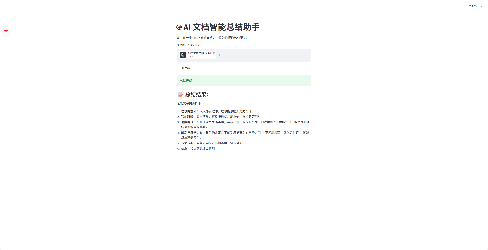

# 🤖 AI 文档智能总结助手

一个基于 Python、LangChain 和 Streamlit 构建的 AI 文本摘要 Web 应用。



## ✨ 功能特性
- **Web 交互界面**：基于 Streamlit 搭建，支持用户直接在浏览器上传文件并实时查看结果。
- **智能语义分析**：接入 DeepSeek 大语言模型，实现高精度的文档摘要与要点提取。
- **安全规范**：使用环境变量（`.env`）管理 API Key，代码中不包含任何明文密钥。
- **模块化设计**：基于 LangChain 的 LCEL 表达式构建提示词流水线，方便后续扩展。

## 📖 项目简介
本项目最初是一个命令行脚本，现已升级为一个包含完整前后端的 Web 应用。用户只需上传一个 `.txt` 格式的文本文档，系统会调用大模型对文档进行阅读，并返回结构化的总结结果。

## 🛠️ 技术栈
- **前端/界面**：Streamlit
- **大模型框架**：LangChain (LCEL, ChatPromptTemplate, TextLoader)
- **大语言模型**：DeepSeek API (兼容 OpenAI 接口)
- **环境管理**：python-dotenv

## 🚀 本地运行指南

**1. 克隆项目并安装依赖：**
```bash
git clone https://github.com/zhaokai-nice1/ai-doc-assistant.git
cd ai-doc-assistant
pip install -r requirements.txt
